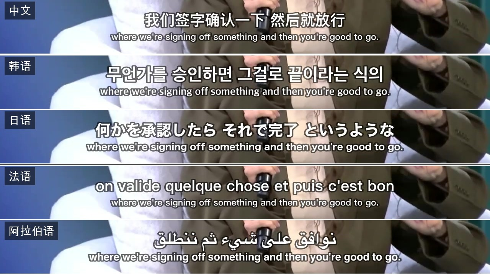
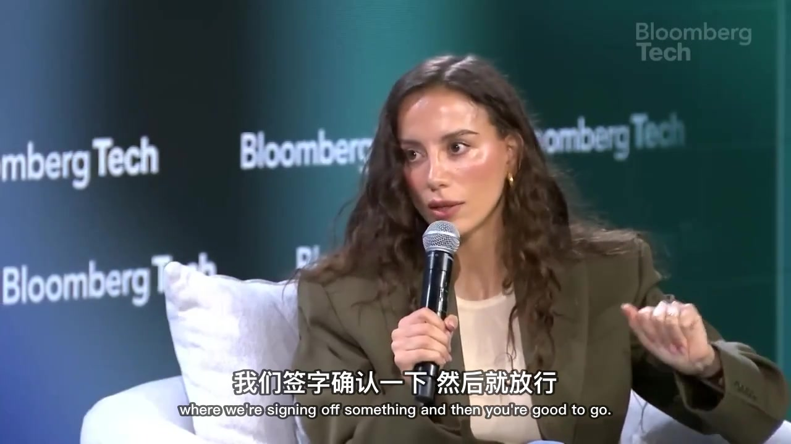

# video-translate

> One sentence turns a foreign-language video into a **Chinese-subtitled video + a clean transcript**. Download → transcribe → translate → polish → burn-in, end to end, all local, zero transcription API cost.

**Language:** [English](README.md) | [中文](README.zh-CN.md)

---

A set of **Skills** for AI coding CLIs that turn any foreign-language video into a Chinese-subtitled video plus a clean transcript — download, transcribe, translate, polish, and burn-in, end to end. It's just scripts + a skill instruction file, **not locked to any single tool**: [Claude Code](https://claude.com/claude-code), OpenClaw, Gemini CLI, Codex all work.

### End-to-end pipeline

```
video URL / local file
        │
        ▼
  ① download → ② audio + Whisper transcribe → ③ translate → ④ polish → ⑤ burn-in subtitles
                   (word-level timestamps)    (any language→中文)  (line-break/align)      │
        │                                                                                  ▼
        └────────────────────────────────────────►  Chinese-subtitled video + Markdown transcript
```

### Multi-language

Not English-only. **English, Japanese, Korean, French, Spanish… anything Whisper can hear gets translated into Chinese.** Whisper auto-detects the source language; the polishing step translates any of them into Chinese.

### Why

- **Local, free, offline-capable.** Transcription runs on [Whisper](https://github.com/openai/whisper) (MLX + Metal GPU on Apple Silicon); translation reuses the AI you already have. No paid transcription/translation API.
- **Accurate timestamps** — word-level, cut by sentence + pause, so subtitles don't run ahead of the speaker.
- **Human-grade subtitles** — fixes ASR mishears, breaks lines by meaning, keeps technical terms in English. Bilingual mode uses real ASS for a true size contrast (Chinese large, English small).
- **Burn-in + watermark in one encode.**

### The three skills

| Skill | Role |
|-------|------|
| **vt-video-md** | Orchestrator: download / audio / Whisper / call the polisher / burn-in / Markdown |
| **vt-subtitle-polish** | Subtitle translation & polishing: fixes, translation, line-breaking, timestamp alignment, bilingual ASS |
| **vt-video-download** | Pure downloader: video / audio / playlists / burn subs onto a local file |

### Demo

One a16z English talk, subtitled into 5 languages — Chinese / Japanese / Korean / Arabic / French — each translation on top, the English original below. Even right-to-left Arabic lines up cleanly:



Burned into the frame (Chinese large, English small, pinned to the bottom):



### Which AI coding tools

The core is scripts + a `SKILL.md` per skill — **any agent that can read a skill/instruction file and run shell commands can drive it.** Loading differs per tool:

- **Claude Code** — native skills; `install.sh` drops them into `~/.claude/skills/`
- **OpenClaw** — also skill-based; install via its `openclaw skills`
- **Gemini CLI** — a `gemini-extension.json` is included
- **Codex & others** — feed the `SKILL.md` as instructions and let it call the `scripts/`, or run the scripts directly

### Install

**macOS (best, especially Apple Silicon):**

```bash
brew install yt-dlp ffmpeg
pip3 install --break-system-packages mlx-whisper   # or faster-whisper on non-Apple-Silicon
git clone https://github.com/jyucoeng/video-translate.git
cd video-translate && bash install.sh
```

**Windows** — this project is tuned for Mac. Easiest path is **WSL2 + Ubuntu**, then it behaves like Linux. For native Windows, three differences:

1. Use **faster-whisper**, not mlx-whisper (MLX is Apple-Silicon-only; the script auto-falls-back): `pip install yt-dlp faster-whisper` + `winget install Gyan.FFmpeg`
2. `install.sh` is bash — run it under Git Bash, or manually copy the three `skills/` folders into your tool's skill directory and copy each `config.example.json` to `config.json`
3. Swap the burn-in font: change `FontName=PingFang SC` to `FontName=Microsoft YaHei`, and the watermark font path to a Windows font (e.g. `C:/Windows/Fonts/msyh.ttc`)

**Linux** — same as WSL: `apt install ffmpeg` + `pip install yt-dlp faster-whisper`, and use a CJK font (e.g. Noto Sans CJK) for burn-in.

Then set `output_dir` (absolute path) in `~/.claude/skills/vt-video-md/config.json`. The MLX model auto-downloads on first run — no manual download needed.

> `whisper-cpp` is an **optional fallback engine**; the default mlx-whisper / faster-whisper path doesn't need it. Only `brew install whisper-cpp` (and download the ggml models to `~/.cache/whisper-cpp/`) if you specifically want whisper-cli for fastest text-only transcription.

### Usage

Restart your AI tool, then just say:

- *"Translate this link into a Chinese-subtitled video: https://youtu.be/xxxx"*
- *"Translate this Japanese video with bilingual subtitles: https://..."*
- *"Just transcribe this to text: https://..."*
- *"Add Chinese subtitles to my local file ~/Movies/talk.mp4"*

### License

[MIT](./LICENSE). Don't commit your own `config.json` or any Douyin login state to a public repo (already excluded by `.gitignore`).
